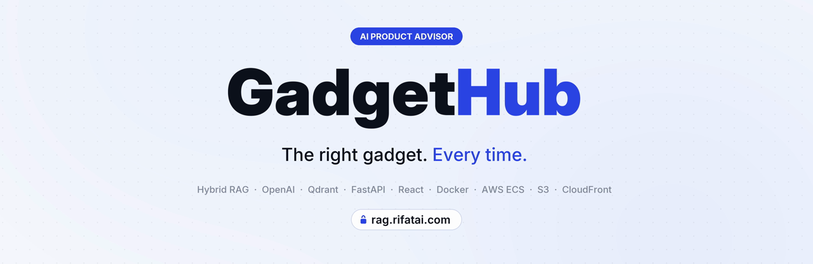
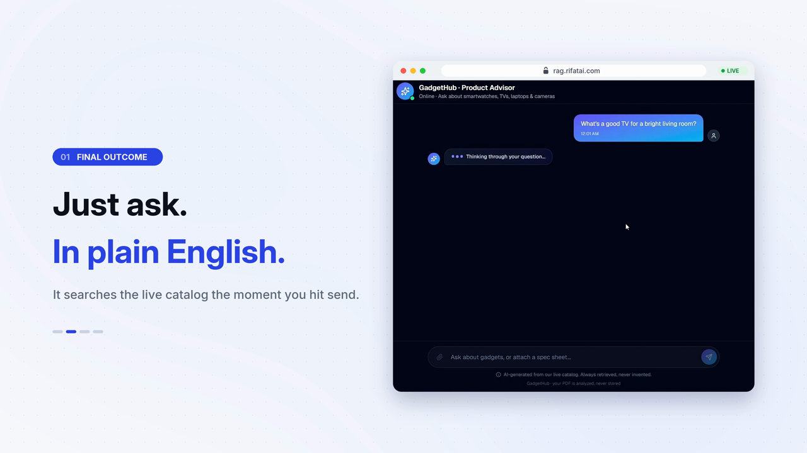
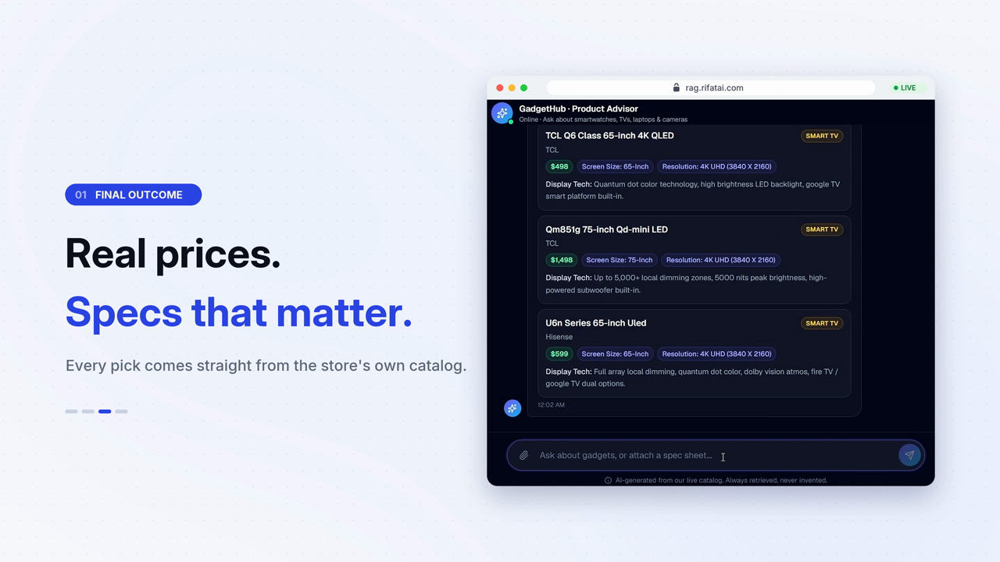
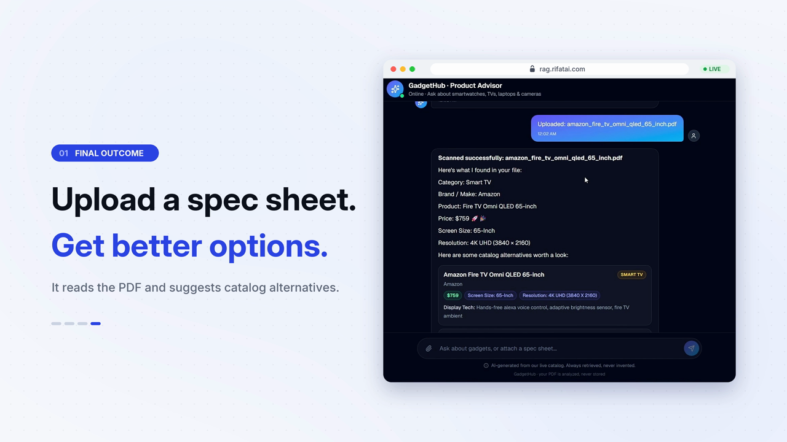
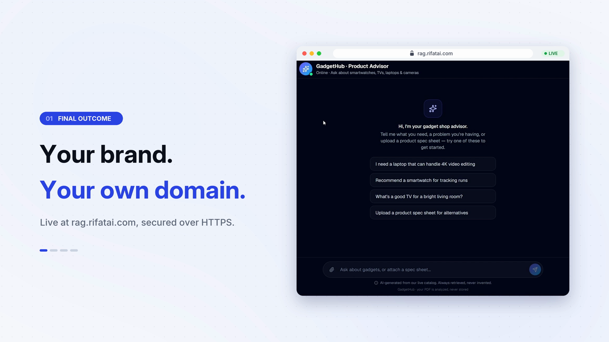
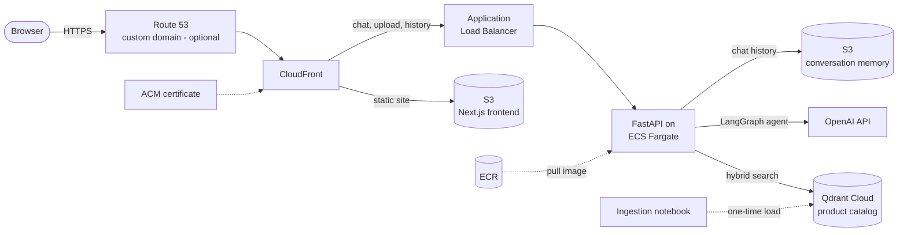

<div align="center">



# GadgetHub

**An AI product advisor for electronics stores.**

Shoppers describe what they need in their own words and get the right TV, laptop, camera or smartwatch from the store's own catalog, with real prices and the specs that matter. They can even upload a spec sheet and get better options back.

[](https://www.python.org/)
[](https://fastapi.tiangolo.com/)
[](https://platform.openai.com/)
[](https://langchain-ai.github.io/langgraph/)
[](https://qdrant.tech/)
[](https://nextjs.org/)
[](https://react.dev/)
[](https://www.typescriptlang.org/)
[](https://www.docker.com/)
[](https://aws.amazon.com/ecs/)
[](https://aws.amazon.com/cloudfront/)
[](https://aws.amazon.com/s3/)
[](https://www.terraform.io/)

[Features](#why-gadgethub) · [Screenshots](#screenshots) · [Architecture](#architecture) · [Tested behaviour](#tested-behaviour) · [Quick start](#quick-start-local) · [Deploy](#deploy-one-command) · [Deployment guide](DEPLOYMENT.md)

</div>

---

## At a glance

<table>
<tr>
<td align="center" width="20%">⚙️<br/>Setup<br/><b>Edit 1 text file</b></td>
<td align="center" width="20%">🚀<br/>Deploy<br/><b>1 command</b></td>
<td align="center" width="20%">🌐<br/>Custom domain<br/><b>1 setting</b>, free SSL</td>
<td align="center" width="20%">🧹<br/>Teardown<br/><b>1 command</b></td>
<td align="center" width="20%">🛡️<br/>Accuracy<br/><b>Every fact retrieved, never invented</b></td>
</tr>
</table>

## Why GadgetHub

*"OLED or QLED?" "16 GB or 32 GB?" "What can I get under $2,000?"* Shoppers face hundreds of near-identical spec sheets, and store staff answer the same questions all day. GadgetHub answers them instantly. A shopper says what they need, or just describes a problem ("my laptop can't handle video editing anymore"), and an AI agent runs a **hybrid search over the store's Qdrant catalog** and recommends products that really exist, with real prices.

| | |
|---|---|
| 💬 **Just ask, in plain English** | Shoppers can name a product, describe a problem or drop a hint ("I'm training for a marathon"); the agent works out the category and searches. |
| 🏷️ **Real prices, specs that matter** | Every pick comes straight from the store's catalog. Product cards show the price and the spec fields that matter for that category. |
| 🎯 **No hallucinations** | The model never answers product questions from memory. Product cards are built directly from the retrieved data, so they can't disagree with the catalog. |
| 📄 **Upload a spec sheet, get better options** | A shopper uploads a product PDF; GadgetHub extracts its details and suggests catalog alternatives. The file is parsed in memory and never stored. |
| ⚡ **Streams with live status** | Replies stream in as they're written, with real progress from the agent's tool calls: thinking, searching the catalog, reviewing results. |
| 🛡️ **Stays on topic** | The agent is instructed to decline anything unrelated to gadgets and steer back to smartwatches, TVs, laptops and cameras. |
| 🧠 **Remembers the conversation** | Follow-ups keep their context; history is stored per session in S3, and one click starts a new chat. |
| 🌐 **Your brand, your own domain** | Served on the store's own HTTPS domain with a free ACM certificate; the default CloudFront URL redirects to it. |

## Screenshots

<table>
<tr>
<td width="50%"><br/><p align="center"><b>Just ask. In plain English.</b></p></td>
<td width="50%"><br/><p align="center"><b>Real prices. Specs that matter.</b></p></td>
</tr>
<tr>
<td width="50%"><br/><p align="center"><b>Upload a spec sheet. Get better options.</b></p></td>
<td width="50%"><br/><p align="center"><b>Your brand. Your own domain.</b></p></td>
</tr>
</table>

## Architecture



- **One HTTPS domain.** CloudFront serves the UI and proxies the API, so there is no CORS to get right in the cloud and only one public link.
- **Locked-down backend.** The load balancer only accepts traffic from CloudFront's managed prefix list, and `/chat`, `/upload` and `/conversation/*` require the shared API key.
- **Always warm.** The API runs on ECS Fargate behind an ALB, not Lambda, and connects to Qdrant at boot, so a shopper's first message never pays a cold start.
- **Read-only catalog at runtime.** The API never writes to the vector store; the catalog is loaded once by the ingestion notebook.
- **Stateless containers.** Conversation history lives in S3, so tasks can be replaced or scaled without losing context.

**How a request flows**

1. The shopper types a question; the UI posts it to `/chat` on the same domain and opens a streamed (SSE) response.
2. The API loads the session history and builds a LangGraph agent with one tool, `search_products`.
3. The agent classifies the message (demand, problem, hint or small talk) and picks a category.
4. `search_products` runs a hybrid (dense + sparse) search in Qdrant, filtered by category, with an unfiltered fallback.
5. Status updates and the reply stream back as they happen; the final event carries the products, which the UI renders as cards.
6. The exchange is saved to S3 under the session ID.

## Tested behaviour

Recorded on the live deployment in the product demo:

| You do | GadgetHub returns |
|---|---|
| Ask *"What's a good TV for a bright living room?"* | Smart TV cards straight from the catalog, including **TCL Q6 Class 65-inch 4K QLED ($498)**, **Hisense U6n Series 65-inch ULED ($599)**, **Roku Plus Series 65-inch QLED 4K ($649)**, **TCL QM851G 75-inch QD-Mini LED ($1,498)** and **Samsung QN90D 75-inch 4K Neo QLED ($2,599)**, each with screen size, resolution and display technology. |
| Upload `amazon_fire_tv_omni_qled_65_inch.pdf` | "Scanned successfully". It extracts **Category: Smart TV, Brand: Amazon, Price: $759, Screen size: 65-inch, Resolution: 4K UHD (3840 × 2160)**, then lists catalog alternatives such as the TCL Q6 Class 65-inch ($498). |
| Open the CloudFront URL | **301 redirect** to the custom domain over HTTPS. |

## Engineering highlights

- **Grounding by construction.** Product cards come from the retrieved Qdrant metadata, not from parsing the model's prose, and the prompt forbids restating specs. The UI can't show a price the catalog doesn't have.
- **Hybrid retrieval with a safety net.** Dense embeddings (`text-embedding-3-small`) plus sparse vectors, a category filter matched against stored values, and an automatic unfiltered retry so a category mismatch never loses a real match.
- **One product per chunk.** Ingestion stages every product into its own file and keeps `chunk_size` above the largest product, so a retrieved chunk never carries half a product's specs.
- **Real streaming status.** LangChain callbacks turn tool starts and ends into live status events over SSE, instead of a fake spinner.
- **Latency work where it counts.** The RAG pipeline and catalog filter values are warmed at boot and cached per process, which removes an extra LLM round-trip from every turn.
- **Infrastructure as code.** S3, ECR, ECS, ALB, CloudFront, ACM and Route 53 are defined in Terraform with dev / test / prod workspaces, plus a CloudFront function for the canonical domain.
- **Cross-platform one-command ops.** Deploy and destroy scripts in Bash and PowerShell read one `.env`, verify the AWS account and catch placeholder keys before touching anything.

## Project structure

```
gadgethub/
├── .env.example                  # ← copy to .env: the ONLY file you need to edit to deploy
├── backend/
│   ├── server.py                 # FastAPI: /chat (SSE), /upload, /conversation, /health
│   ├── rag_engine.py             # RAGWire + LangGraph agent, search_products tool, status streaming
│   ├── pdf_intake.py             # spec-sheet PDF → extracted fields → catalog alternatives (never stored)
│   ├── memory.py                 # per-session history (local JSON or S3)
│   ├── auth.py                   # X-API-Key gate
│   ├── pipeline.yaml             # embeddings, LLM, Qdrant and retriever settings
│   └── metadata.yaml             # product metadata schema (matches ingestion)
├── frontend/
│   └── components/
│       └── gadgethub-advisor.tsx # chat UI: live status, product cards, PDF upload, new chat
├── ingestion/
│   ├── rag_pipeline.ipynb        # loads the catalog PDFs into Qdrant, one product per chunk
│   └── ingest.md                 # catalog PDF layout and how to add products or categories
├── terraform/                    # all AWS infrastructure
└── scripts/                      # deploy / destroy (Bash + PowerShell) + shared .env loaders
```

## Customize

1. **Load your catalog.** Put your catalog PDFs in `gadgethub/data/` and run `ingestion/rag_pipeline.ipynb` once. See [`ingest.md`](gadgethub/ingestion/ingest.md) for the PDF layout per category.
2. **Set your config.** Copy `gadgethub/.env.example` to `gadgethub/.env` and set your AWS account, OpenAI and Qdrant keys and (optionally) your domain.
3. **Redeploy.** `./scripts/deploy.sh dev`

That's it. No code changes.

> **Tip:** re-running the notebook is safe and cheap; file-hash dedup skips products that are already ingested, so adding new stock is just dropping in a PDF and running it again.

## Quick start (local)

**Prerequisites:** Python 3.12 with [uv](https://docs.astral.sh/uv/), Node.js 20+, an OpenAI key and a Qdrant Cloud cluster with the catalog ingested.

```bash
git clone https://github.com/rifatislamzeemshaurov/gadgethub.git
cd gadgethub/gadgethub
cp .env.example .env                 # set OPENAI_API_KEY, QDRANT_URL, QDRANT_API_KEY, API_KEY_UI

cd backend && uv sync && uv run uvicorn server:app --reload     # http://127.0.0.1:8000

# second terminal
cd frontend
printf 'NEXT_PUBLIC_API_URL=http://localhost:8000\nNEXT_PUBLIC_API_KEY=<your API_KEY_UI>\n' > .env.development
npm install && npm run dev                                      # http://localhost:3000
```

Open **http://localhost:3000** and click *"What's a good TV for a bright living room?"*.

## Deploy (one command)

**Prerequisites:** AWS CLI, Terraform 1.0+, Docker, Node.js 20+, and a filled-in `gadgethub/.env`. Run from the `gadgethub/` folder.

| Action | macOS / Linux / Git Bash | Windows PowerShell |
|---|---|---|
| **Deploy** | `./scripts/deploy.sh dev` | `.\scripts\deploy.ps1 -Environment dev` |
| **Deploy on your domain** | set `USE_CUSTOM_DOMAIN=true` in `.env`, then `./scripts/deploy.sh dev` | same `.env` setting, then `.\scripts\deploy.ps1 -Environment dev` |
| **Destroy** | `./scripts/destroy.sh dev` | `.\scripts\destroy.ps1 -Environment dev` |

Environments `dev`, `test` and `prod` are fully separate stacks, each with its own Terraform workspace and resources prefixed `<PROJECT_NAME>-<environment>-*`.

The deploy script checks Docker, the AWS account and every required key, creates the ECR repository, builds and pushes the backend image, applies Terraform (S3, ECS, ALB, CloudFront, and ACM + Route 53 for the domain), waits for the service to pass health checks, builds the frontend against the live domain, uploads it to S3, and invalidates the CloudFront cache.

### Custom domain

Point `DOMAIN_NAME` at a public Route 53 hosted zone and set `APP_SUBDOMAIN` (for example `shop` → `https://shop.example.com`). Terraform issues and validates a free ACM certificate, creates the A and AAAA alias records, and attaches a CloudFront function that **301-redirects any other hostname, including the default CloudFront URL, to your domain**.

Full operations guide: **[DEPLOYMENT.md](DEPLOYMENT.md)**.

## API

`/chat`, `/upload` and `/conversation/*` require the `X-API-Key` header to match `API_KEY_UI`.

| Method | Path | Description |
|---|---|---|
| `GET` | `/health` | `{"status": "healthy"}` (used by the load balancer) |
| `POST` | `/chat` | Body `{"message", "session_id?"}`. Server-sent events: `status`, `token`, then `final` with `{"response", "products": [{"category", "brand_or_make", "product_name", "price", "specs"}], "session_id"}` |
| `POST` | `/upload` | Multipart `file` (PDF) and optional `session_id` → `{"success", "session_id", "message", "extracted", "alternatives"}` |
| `GET` | `/conversation/{session_id}` | Stored history: `{"session_id", "messages": [...]}` |

## Security & privacy

- **Secrets** come from `.env`, which is git-ignored; the deploy script passes them to Terraform as variables, and they reach the container as task environment variables. Nothing secret is committed or baked into the image.
- **Access control:** protected endpoints require the shared API key and fail closed if it is unset; CORS is restricted to the app's own domain in AWS.
- **Uploaded PDFs** are parsed through a temporary file that is deleted immediately; they are never embedded or written to the vector store.
- **Private storage:** the conversation-memory bucket blocks all public access; the frontend bucket only holds the public static site.
- **Locked-down origin:** the load balancer only accepts requests from CloudFront.
- **What it does not do:** it never answers product questions from the model's general knowledge, and it never modifies the catalog at runtime.

## Roadmap

- [ ] Move runtime secrets to AWS Secrets Manager
- [ ] Side-by-side product comparison view
- [ ] "Add to cart" links into the store's e-commerce platform
- [ ] Admin page to upload new catalog PDFs without the notebook
- [ ] More categories: phones, audio and gaming

---

<p align="center"><sub>Built by RIZS</sub></p>
